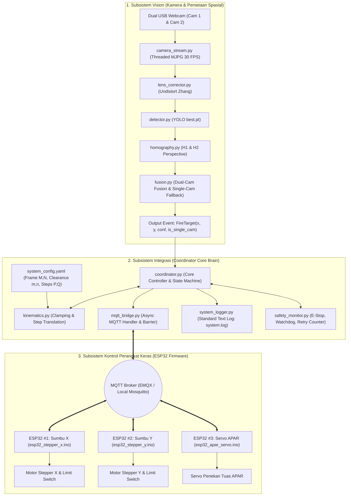
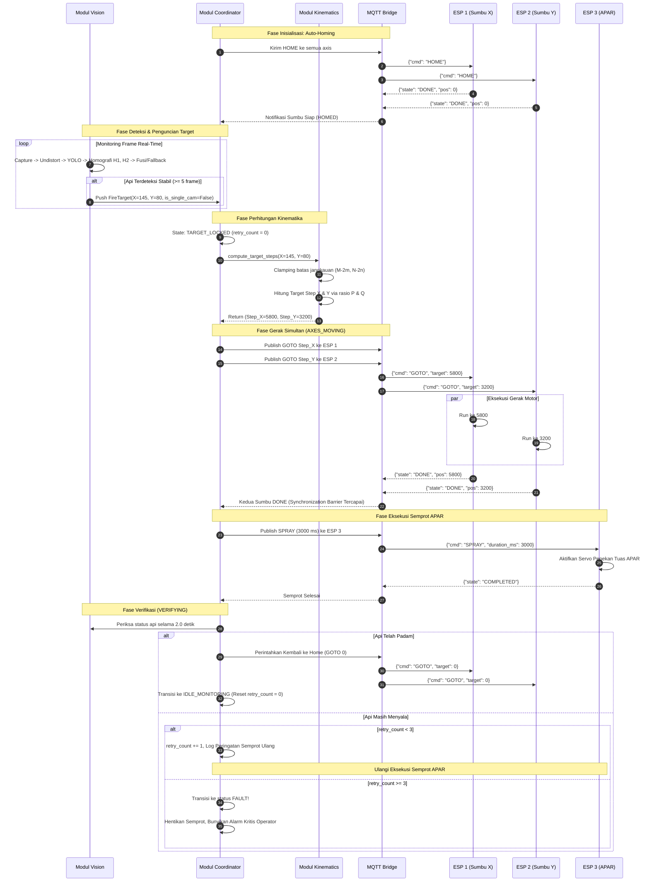

# Blueprint Arsitektur Sistem Perangkat Lunak Deezpro (ARCH_PLAN.md) — Revisi v1.1

Dokumen ini merinci rencana arsitektur perangkat lunak menyeluruh (*system software architecture blueprint*) untuk sistem pemadam api otomatis Deezpro. Desain arsitektur ini menerapkan prinsip **pemisahan tanggung jawab (*Separation of Concerns*)** dan **modularitas tinggi (*High Cohesion, Loose Coupling*)**, di mana subsistem kamera (*Computer Vision*), subsistem aktuator perangkat keras (*ESP32 Firmware*), dan subsistem pengarah utama (*Integration Coordinator*) dipisahkan secara independen dan dihubungkan melalui antarmuka (*interface/data contract*) yang terdefinisi secara baku.

---

## 1. Diagram Arsitektur Sistem Menyeluruh

Diagram arsitektur berfokus murni pada alur kritis (*core operational pipeline*) yang diperlukan agar sistem dapat mendeteksi dan memadamkan api secara otonom:



> [!NOTE]
> Fitur antarmuka visual tambahan (*Operator Web Dashboard* dan *Digital Twin 2D Canvas*) serta *Database Audit SQLite* telah dipindahkan ke **Milestone 5 (Opsional / Post-MVP)** agar tim fokus menyelesaikan fungsionalitas utama pemadaman api terlebih dahulu.

---

## 2. Struktur Direktori Modular yang Direkomendasikan

Struktur kode diorganisir di dalam folder `Software/` untuk memisahkan domain secara tegas dan bersih:

```text
Software/
├── config/
│   ├── system_config.yaml          # Konfigurasi dimensi frame, clearance, step P&Q, MQTT
│   ├── calib_cam1.npz              # Matriks intrinsik & distorsi Kamera 1
│   ├── calib_cam2.npz              # Matriks intrinsik & distorsi Kamera 2
│   ├── homography_cam1.npz         # Matriks homografi H1
│   └── homography_cam2.npz         # Matriks homografi H2
│
├── src/
│   ├── vision/                     # SUBSISTEM KAMERA & DETEKSI
│   │   ├── __init__.py
│   │   ├── camera_stream.py        # Pengambilan frame threaded MJPG 30 FPS
│   │   ├── lens_corrector.py       # Koreksi distorsi lensa (cv2.remap)
│   │   ├── detector.py             # Inferensi YOLO (Api & Asap)
│   │   ├── homography.py           # Transformasi proyektif citra ke bidang fisik
│   │   ├── fusion.py               # Fusi dual-kamera, fallback single-cam, & smoothing
│   │   └── vision_pipeline.py      # Facade yang menggabungkan seluruh alur visi
│   │
│   ├── firmware/                   # SUBSISTEM KONTROL HARDWARE (ESP32)
│   │   ├── common/
│   │   │   └── deezpro_protocol.h  # Definisi struktur pesan & topik MQTT bersama
│   │   ├── esp32_stepper_x/
│   │   │   └── esp32_stepper_x.ino # Firmware penggerak Sumbu X + Limit Switch
│   │   ├── esp32_stepper_y/
│   │   │   └── esp32_stepper_y.ino # Firmware penggerak Sumbu Y + Limit Switch
│   │   └── esp32_apar_servo/
│   │       └── esp32_apar_servo.ino# Firmware pemicu servo tuas APAR
│   │
│   └── integration/                # SUBSISTEM INTEGRASI & KOORDINASI UTAMA
│       ├── __init__.py
│       ├── kinematics.py           # Clamping batas railing & konversi koordinat -> step
│       ├── mqtt_bridge.py          # Wrapper MQTT client (Publish & Subscribe handler)
│       ├── coordinator.py          # Otak utama pemadam + State Machine internal
│       ├── system_logger.py        # Logging kejadian berbasis file teks (system.log)
│       └── safety_monitor.py       # Failsafe, heartbeat watchdog, dan emergency halt
│
├── logs/
│   └── system.log                  # File pencatatan aktivitas & galat sistem
│
├── run_system.py                   # Script eksekusi utama (Entry Point)
├── run_vision_only.py              # Script pengujian independen modul visi
├── run_controller_only.py          # Script pengujian independen modul kontrol
└── requirements.txt                # Dependensi Python sistem
```

---

## 3. Rincian & Tanggung Jawab Modul

### 3.1 Modul Vision (`Software/src/vision/`)
Bertanggung jawab mengubah citra optik dari dunia nyata menjadi koordinat spasial 2D $(X_w, Y_w)$ dalam satuan centimeter pada bidang lantai.
* **Isolasi Domain**: Modul ini **tidak boleh mengetahui** protokol MQTT, jenis motor stepper, maupun keberadaan ESP32. Tugasnya murni memproses citra dan menghasilkan objek data `FireTarget`.
* **Komponen**:
  1. `camera_stream.py`: Mengelola pembacaan USB webcam multi-threaded pada hardware MJPG 30 FPS untuk mencegah latency buffer.
  2. `lens_corrector.py`: Melakukan *undistortion* citra secara cepat menggunakan map CV_16SC2 dari parameter kalibrasi Zhang (`calib_cam1.npz`, `calib_cam2.npz`).
  3. `detector.py`: Memuat model YOLO (`best.pt`), mengeksekusi inferensi, dan mengekstrak *bounding box* serta titik kontak dasar api (*base-center*).
  4. `homography.py`: Memetakan titik citra $(u, v)$ ke koordinat fisik lantai $(X_w, Y_w)$ menggunakan matriks $H_1$ dan $H_2$.
  5. `fusion.py`: Menguji konsistensi jarak antar dua kamera, melakukan fusi rata-rata berbobot, menerapkan *exponential moving average* (EMA), dan menyediakan mekanisme **Fallback Single-Camera** jika salah satu kamera terhalang.
  6. `vision_pipeline.py`: Menyediakan fungsi publik tunggal `get_latest_fire_target() -> Optional[FireTarget]`.

### 3.2 Modul Firmware ESP32 (`Software/src/firmware/`)
Bertanggung jawab mengendalikan aktuator mekanik fisik secara presisi dan deterministik di level mikrokontroler.
* **Isolasi Domain**: Firmware mikrokontroler **tidak melakukan perhitungan koordinat lantai**. Firmware hanya menerima target langkah (*steps*) atau perintah sudut/durasi semprot, serta melaporkan status hardware (posisi langkah, limit switch, kondisi idle/done/error).
* **Komponen**:
  1. `esp32_stepper_x.ino`: Mengendalikan motor Sumbu X via driver (A4988/DRV8825) dengan pustaka `AccelStepper`, mengeksekusi `HOME` saat startup menggunakan limit switch X, dan melaporkan posisi real-time via MQTT.
  2. `esp32_stepper_y.ino`: Mengendalikan motor Sumbu Y identik dengan modul Sumbu X, independen pada limit switch Y.
  3. `esp32_apar_servo.ino`: Mengendalikan sudut motor servo untuk menekan tuas APAR selama durasi waktu tertentu (*non-blocking timer* `millis()`), lalu melepas kembali tuas.

### 3.3 Modul Integrasi (`Software/src/integration/`)
Bertindak sebagai **"Otak Pusat" (Central Coordinator)** yang menjembatani dunia persepsi (Vision) dengan dunia aksi (Firmware).
* **Komponen**:
  1. `kinematics.py`:
     - Membaca batasan frame fisik ($M, N$) dan clearance railing ($m, n$) dari `system_config.yaml`.
     - Melakukan fungsi **Clamping** jika titik api berada di luar jangkauan railing (mencari titik jangkauan terdekat).
     - Mengonversi koordinat target centimeter $(X_t, Y_t)$ menjadi nilai integer target langkah motor $(\text{Step}_X, \text{Step}_Y)$ berbasis rasio resolusi $P$ dan $Q$.
  2. `mqtt_bridge.py`:
     - Menangani koneksi jaringan MQTT (Paho-MQTT), enkapsulasi serialization/deserialization JSON, serta mekanisme *callback* penerimaan status dari ketiga ESP32.
  3. `coordinator.py` *(Menggabungkan Controller & State Machine)*:
     - Mengelola siklus status sistem yang telah disederhanakan:
       ```text
       BOOT_HOMING -> IDLE_MONITORING -> TARGET_LOCKED -> AXES_MOVING 
       -> SYNC_BARRIER -> SPRAYING -> VERIFYING -> RETURN_HOME (atau FAULT)
       ```
     - Logika kerja utama: Mengambil target api dari `vision_pipeline` $\to$ menghitung target step via `kinematics` $\to$ menerbitkan perintah gerak simultan ke ESP 1 & ESP 2 $\to$ menunggu status `DONE` dari kedua sumbu (*Synchronization Barrier*) $\to$ memerintahkan ESP 3 menyemprot $\to$ memverifikasi pemadaman hingga maksimal 3 kali percobaan sebelum masuk status `FAULT`.
  4. `system_logger.py`:
     - Mencatat seluruh aktivitas operasional, peringatan, dan galat sistem ke dalam file teks harian (`logs/system.log`).
  5. `safety_monitor.py`:
     - Mengawasi batas timeout gerakan motor, mendeteksi hilangnya koneksi MQTT (*heartbeat check*), dan menangani tombol darurat (*Emergency Stop / E-STOP*).

---

## 4. Penanganan Skenario Kegagalan (Failure Scenarios & Edge Cases)

Untuk menjamin keandalan sistem di kondisi riil, arsitektur ini secara eksplisit menangani skenario kegagalan operasional berikut:

### 4.1 Target Api Hilang saat Railing Sedang Bergerak
* **Gejala**: Model YOLO kehilangan deteksi api di tengah jalan (misal api tertutup asap pekat sesaat atau tertiup angin).
* **Solusi Arsitektur**:
  1. Railing **tetap menyelesaikan pergerakan** ke koordinat terakhir yang terkunci (*last known coordinate*).
  2. Begitu sampai di target, sistem memasuki masa tunggu verifikasi sensor selama $t_{\text{verify}}$ (misal 2.0 detik).
  3. Jika api tetap tidak terdeteksi setelah masa tunggu, sistem **membatalkan aksi penyemprotan (*abort spray*)**, mencatat log peringatan `[WARN] Target lost before spray. Aborting action.`, lalu mengembalikan railing ke posisi `HOME`.

### 4.2 Target Api Bergeser/Merambat saat Railing Sedang Bergerak
* **Gejala**: Sumber api berpindah atau merambat ke lokasi baru saat motor sedang dalam perjalanan.
* **Solusi Arsitektur**:
  1. Modul koordinasi menghitung jarak pergeseran $\Delta d = \|P_{\text{baru}} - P_{\text{target\_aktif}}\|$.
  2. **Jika $\Delta d \le \text{Radius\_Semprot}$ (misal $\le 20$ cm)**: Railing tetap menyelesaikan gerakan ke target aktif dan langsung menyemprot, karena titik baru masih berada di dalam cakupan siraman corong APAR.
  3. **Jika $\Delta d > \text{Radius\_Semprot}$**: Railing menyelesaikan perhentian pada target aktif terlebih dahulu untuk menjaga inersia mekanik, lalu segera mengeksekusi perhitungan *clamping* baru dan menerbitkan perintah `GOTO` susulan ke posisi baru sebelum tuas APAR ditekan.

### 4.3 Salah Satu Kamera Tidak Mendeteksi Api (Fallback Single-Camera)
* **Gejala**: Kamera 1 terhalang oklusi (tiang, sudut ruangan, atau asap tebal), namun Kamera 2 dapat melihat api dengan jelas (atau sebaliknya).
* **Solusi Arsitektur (Graceful Degradation)**:
  * Modul `fusion.py` tidak membatalkan proses deteksi. Sebaliknya, modul mengevaluasi ketersediaan deteksi:
    * **Kasus Ideal (Kedua Kamera Aktif)**: Menjalankan uji konsistensi jarak $\|P_1 - P_2\| \le \text{Threshold}$ dan melakukan fusi rata-rata berbobot.
    * **Kasus Fallback Kamera 2 (Kamera 1 Blank)**: Koordinat diambil murni dari proyeksi Kamera 2 $(X_w = X_{w2}, Y_w = Y_{w2})$, flag `is_single_cam = True`, dan dicatat log `[INFO] Operating on single-camera fallback (Cam 2)`.
    * **Kasus Fallback Kamera 1 (Kamera 2 Blank)**: Koordinat diambil murni dari proyeksi Kamera 1 $(X_w = X_{w1}, Y_w = Y_{w1})$, flag `is_single_cam = True`.
    * **Kasus Tidak Ada Deteksi**: Mengembalikan `None`, sistem tetap dalam status `IDLE_MONITORING`.

### 4.4 Pembatasan Siklus Semprot Ulang & Status `FAULT`
* **Gejala**: Api tidak kunjung padam setelah disemprot (misal api terlalu besar, bahan bakar terus mengalir, atau terjadi false alarm membandel pada objek pantulan).
* **Solusi Arsitektur**:
  1. Ditetapkan batas maksimum percobaan semprot: `MAX_SPRAY_RETRIES = 3`.
  2. Terdapat penghitung percobaan (`retry_count`) pada `coordinator.py`.
  3. Setiap kali fase `VERIFYING` mendeteksi api masih menyala:
     - Jika `retry_count < 3`: Naikkan `retry_count += 1`, lakukan penyemprotan ulang.
     - Jika `retry_count >= 3`: Sistem **seketika menghentikan penyemprotan** untuk mencegah habisnya isi tabung APAR secara sia-sia. Sistem berpindah ke status **`FAULT`**, membunyikan alarm darurat, mencatat log kritis `[FATAL] Fire persists after 3 spray attempts. System locked in FAULT state!`, dan mewajibkan intervensi manual oleh operator sebelum dapat di-reset kembali.

---

## 5. Kontrak Data Antar-Modul (Inter-Module Data Contracts)

### 5.1 Vision Output $\rightarrow$ Coordinator (Python Data Class)
```python
from dataclasses import dataclass
from typing import Optional, Tuple

@dataclass
class FireTarget:
    x_cm: float                           # Koordinat X fisik hasil estimasi
    y_cm: float                           # Koordinat Y fisik hasil estimasi
    confidence: float                     # Tingkat keyakinan deteksi (0.0 - 1.0)
    has_smoke: bool                       # Indikator deteksi asap
    is_single_cam: bool                   # True jika estimasi berasal dari 1 kamera (fallback)
    cam1_pos: Optional[Tuple[float, float]] # Posisi mentah dari Kamera 1
    cam2_pos: Optional[Tuple[float, float]] # Posisi mentah dari Kamera 2
    timestamp: float                      # Unix timestamp saat deteksi
    is_stable: bool                       # True jika terverifikasi stabil >= 5 frame
```

### 5.2 Coordinator $\rightarrow$ Firmware ESP32 (MQTT JSON Contract)

#### Perintah Stepper (Topic: `deezpro/rail/x/cmd` dan `deezpro/rail/y/cmd`):
```json
{
  "cmd": "GOTO",
  "target": 1850,
  "speed": 1000.0,
  "accel": 500.0,
  "seq": 104
}
```
*Tersedia juga: `{"cmd": "HOME"}`, `{"cmd": "STOP"}`.*

#### Status Stepper (Topic: `deezpro/rail/x/status` dan `deezpro/rail/y/status`):
```json
{
  "node": "x",
  "state": "DONE",
  "pos": 1850,
  "seq": 104
}
```
*Nilai state valid: `"IDLE"`, `"HOMING"`, `"MOVING"`, `"DONE"`, `"ERROR"`.*

#### Perintah APAR (Topic: `deezpro/apar/cmd`):
```json
{
  "cmd": "SPRAY",
  "duration_ms": 3000,
  "seq": 201
}
```

#### Status APAR (Topic: `deezpro/apar/status`):
```json
{
  "node": "apar",
  "state": "COMPLETED",
  "seq": 201
}
```

---

## 6. Sequence Diagram Siklus Pemadaman Terpadu



---

## 7. Action Plan Implementasi Bertahap

### Milestone 1: Refactoring & Isolasi Modul Vision
1. Pindahkan pembacaan webcam multi-threaded ke `Software/src/vision/camera_stream.py`.
2. Implementasikan koreksi distorsi pada `Software/src/vision/lens_corrector.py`.
3. Buat modul proyeksi dan fusi dual-kamera pada `homography.py` dan `fusion.py` lengkap dengan mekanisme *Fallback Single-Camera*.
4. Uji mandiri modul visi via `run_vision_only.py` tanpa terhubung ke hardware (menampilkan koordinat fisik di konsol).

### Milestone 2: Refactoring Firmware ESP32
1. Perbarui `esp32_stepper_x.ino` dan `esp32_stepper_y.ino` agar menggunakan format JSON baku (`deezpro/rail/x/cmd`, `deezpro/rail/y/cmd`).
2. Integrasikan pin limit switch untuk fungsi auto-homing saat startup.
3. Buat firmware `esp32_apar_servo.ino` untuk kendali servo non-blocking.
4. Uji pergerakan motor dan aktuasi servo secara mandiri menggunakan MQTT Explorer / test script.

### Milestone 3: Pembangunan Core Coordinator & Kinematics
1. Tulis modul `kinematics.py` dengan fungsi *clamping* dan konversi langkah motor.
2. Bangun `mqtt_bridge.py` yang menerapkan *Synchronization Barrier* berbasis threading event.
3. Gabungkan logika alur status ke dalam `coordinator.py` lengkap dengan batasan `MAX_SPRAY_RETRIES = 3` dan transisi `FAULT`.
4. Uji mandiri koordinator via `run_controller_only.py` menggunakan koordinat input simulasi.

### Milestone 4: Integrasi End-to-End & Failsafe (MVP Terpadu)
1. Hubungkan `vision_pipeline` ke `coordinator.py` di dalam script utama `run_system.py`.
2. Jalankan pengujian terpadu skenario nyata:
   - Sumber api diletakkan pada area $2 \times 2$ m $\rightarrow$ kamera mendeteksi $\rightarrow$ homografi menghasilkan titik fisik $\rightarrow$ railing bergerak serentak $\rightarrow$ APAR menyemprot $\rightarrow$ verifikasi $\rightarrow$ nozzle kembali ke posisi awal.
3. Uji skenario kegagalan:
   - Oklusi satu kamera (verifikasi fallback single-camera).
   - Api padam saat railing bergerak (verifikasi pembatalan semprot).
   - Api tidak padam setelah 3 kali semprot (verifikasi transisi ke status `FAULT`).

### Milestone 5: Fitur Tambahan & Operator UI (Opsional / Post-MVP)
1. Pembuatan Web Dashboard / OpenCV GUI untuk visualisasi live streaming kamera.
2. Pembuatan kanvas 2D Digital Twin untuk memantau posisi nozzle real-time.
3. Migrasi pencatatan dari file teks `system.log` ke database SQLite jika diperlukan histori terstruktur jangka panjang.
