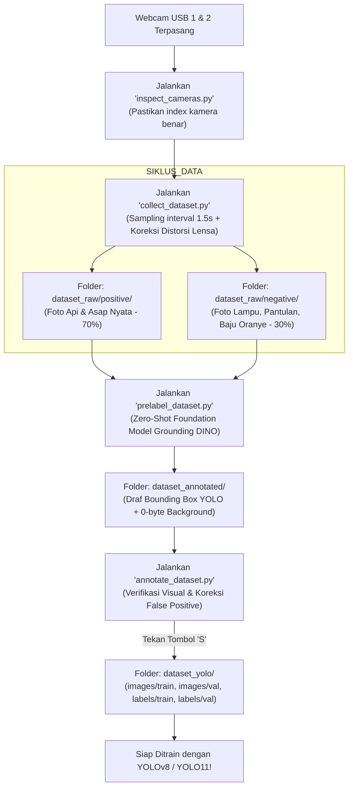

# PANDUAN LENGKAP PENGUMPULAN & ANOTASI DATASET DEEZPRO
*(Sesuai Standar Operasional STEPS.md Fase 1, 2, & 3)*

Panduan manual ini dirancang langkah demi langkah bagi tim pengembang untuk mengumpulkan citra lapangan dari kamera murah, melakukan pelabelan otomatis berbasis AI visi-bahasa (*Foundation Model*), memverifikasi anotasi, hingga menghasilkan dataset siap latih (*training-ready*) untuk model YOLO.

---

## DAFTAR ISI
1. [Alur Kerja Keseluruhan (Workflow Diagram)](#1-alur-kerja-keseluruhan-workflow-diagram)
2. [Persiapan Awal & Penentuan Index Kamera](#2-persiapan-awal--penentuan-index-kamera)
3. [Langkah 1: Pengambilan Citra Lapangan (`collect_dataset.py`)](#3-langkah-1-pengambilan-citra-lapangan-collect_datasetpy)
4. [Langkah 2: Pre-Labeling Otomatis Grounding DINO (`prelabel_dataset.py`)](#4-langkah-2-pre-labeling-otomatis-grounding-dino-prelabel_datasetpy)
5. [Langkah 3: Verifikasi Interaktif Human-in-the-Loop (`annotate_dataset.py`)](#5-langkah-3-verifikasi-interaktif-human-in-the-loop-annotate_datasetpy)
6. [Langkah 4: Pembagian Dataset & Generasi `data.yaml`](#6-langkah-4-pembagian-dataset--generasi-datayaml)
7. [Struktur Folder & Penjelasan File](#7-struktur-folder--penjelasan-file)
8. [Tabel Pintasan Keyboard (Cheatsheet)](#8-tabel-pintasan-keyboard-cheatsheet)
9. [Tips Penting & Troubleshooting](#9-tips-penting--troubleshooting)

---

## 1. Alur Kerja Keseluruhan (Workflow Diagram)



---

## 2. Persiapan Awal & Penentuan Index Kamera

Sebelum mengambil foto, pastikan nomor index hardware kamera tidak tertukar dengan webcam internal laptop.

### Langkah:
1. Buka PowerShell dan masuk ke folder `Software/Development-2`:
   ```powershell
   cd "D:\Tugas\Desain Proyek\Deezpro\Software\Development-2"
   ```
2. Jalankan tool pemeriksa visual:
   ```powershell
   python inspect_cameras.py
   ```
3. **Uji Tutup Lensa**:
   * Tutup fisik lensa Kamera 1 (misal: webcam di sudut kiri) menggunakan tangan Anda.
   * Perhatikan jendela mana di layar yang menjadi gelap. Jika yang gelap adalah `INDEX 1`, berarti Kamera 1 berada di Index 1.
4. **Petakan Kamera**:
   * Tekan tombol **`[TAB]`** untuk memilih kamera tersebut.
   * Tekan tombol **`[1]`** untuk menetapkan Kamera 1.
   * Pindah ke kamera berikutnya dengan **`[TAB]`**, lalu tekan **`[2]`** untuk Kamera 2.
   * Tekan **`[S]`** untuk menyimpan pemetaan ke `config/system_config.yaml`.
   * Tekan **`[Q]`** untuk keluar.

---

## 3. Langkah 1: Pengambilan Citra Lapangan (`collect_dataset.py`)

Skrip ini merekam citra dengan **koreksi distorsi lensa (*undistort*)** dan **interval waktu otomatis** agar tidak terjadi redundansi data.

### Perintah Menjalankan:
```powershell
# Untuk merekam dari Kamera 1:
python collect_dataset.py --source 1 --calib config/calib_cam1.npz --interval 1.5

# Untuk merekam dari Kamera 2:
python collect_dataset.py --source 2 --calib config/calib_cam2.npz --interval 1.5
```

### Prosedur Pengambilan Data Lapangan:

#### A. Mengambil Data Positif (Api & Asap — Target 70% dari Total Dataset)
1. Pastikan HUD di layar menampilkan **`MODE: [POSITIVE]`**.
2. Nyalakan sumber api uji coba di area lantai pantauan (lilin, kaleng pembakaran kecil, atau kertas).
3. Biarkan program mengambil foto secara otomatis setiap 1.5 detik (akan muncul kedipan putih di layar setiap kali foto tersimpan).
4. **Variasikan kondisi**:
   * Ubah jarak api: dekat ($>30\%$ frame), menengah ($10\% - 30\%$), dan jauh ($<10\%$).
   * Biarkan asap mengepul pekat atau menyebar tipis.
   * Jika lidah api berubah bentuk secara dramatis, Anda bisa menekan tombol **`[SPASI]`** kapan saja untuk mengambil foto manual seketika.

#### B. Mengambil Data Negatif (Hard Negative / Background — Target 30% dari Total Dataset)
1. Matikan api uji coba.
2. Tekan tombol **`[M]`** pada keyboard. Mode di layar akan berganti menjadi **`MODE: [NEGATIVE]`**.
3. Arahkan kamera atau letakkan objek pengecoh di lantai:
   * Lampu sorot, bohlam kuning, atau senter yang menyala terang.
   * Pantulan cahaya jendela pada lantai keramik yang mengkilap.
   * Pakaian/kain warna merah atau oranye terang.
   * Kondisi ruangan kosong pada berbagai pencahayaan (lampu dinyalakan, diredupkan, dan dimatikan).
4. Tekan **`[Q]`** jika total sampel sudah mencukupi (rekomendasi: minimal 100 foto positif dan 40 foto negatif).

*Seluruh foto otomatis tersimpan di folder `dataset_raw/positive/` dan `dataset_raw/negative/`.*

---

## 4. Langkah 2: Pre-Labeling Otomatis Grounding DINO (`prelabel_dataset.py`)

Daripada menggambar ratusan bounding box secara manual dari nol, gunakan **Zero-Shot Foundation Model (Grounding DINO)** untuk melabeli seluruh folder mentah secara batch.

### Mengapa Grounding DINO?
Model ini memahami teks bahasa alami `"fire"` dan `"smoke"` secara semantik terbuka. Model ini kebal terhadap noise kamera murah dan tidak bias seperti model lama yang hanya dilatih pada dataset publik.

### Perintah Menjalankan:
```powershell
python prelabel_dataset.py --backend grounding_dino --box-thresh 0.30
```
> *(Catatan: Pada eksekusi pertama kali, sistem akan mengunduh bobot resmi Grounding DINO dari HuggingFace sebesar ~150MB secara otomatis).*

### Apa yang Dilakukan Skrip Ini?
1. Membaca seluruh foto di folder `dataset_raw/`.
2. Mendeteksi nyala api dan memberinya label **`1: fire`**.
3. Mendeteksi asap kepulan dan memberinya label **`0: smoke`**.
4. Foto pada subfolder `negative/` otomatis diberi file label `.txt` **kosong berukuran 0 byte** (sinyal wajib YOLO untuk data *hard negative*).
5. Hasil disimpan ke folder `dataset_annotated/`.

---

## 5. Langkah 3: Verifikasi Interaktif Human-in-the-Loop (`annotate_dataset.py`)

Setelah proses batch selesai, Anda sebagai manusia (*Human-in-the-Loop*) cukup melakukan verifikasi cepat untuk memeriksa draf kotak yang telah dibuat.

### Perintah Menjalankan:
```powershell
python annotate_dataset.py --raw dataset_raw --out dataset_annotated
```

### Prosedur Kerja di Jendela GUI:
1. Layar akan menampilkan foto beserta bounding box:
   * **Kotak Merah**: Menandakan `1: fire`.
   * **Kotak Kuning/Cyan**: Menandakan `0: smoke`.
2. **Koreksi Cepat**:
   * **Jika kotak sudah pas**: Tekan **`[SPASI]`** atau **`[ENTER]`** untuk menyimpan dan langsung berpindah ke foto berikutnya.
   * **Jika model salah mengira bohlam sebagai api (*False Positive*)**: Cukup **KLIK KANAN** pada kotak bohlam tersebut untuk menghapusnya!
   * **Jika ada api kecil yang terlewat (*False Negative*)**: **KLIK KIRI & DRAG MOUSE** untuk menggambar kotak baru.
   * **Jika kelasnya tertukar**: Tekan tombol **`[0]`** (untuk smoke) atau **`[1]`** (untuk fire).
   * **Jika foto tersebut adalah ruangan kosong/background**: Tekan tombol **`[B]`** agar statusnya menjadi *Background (0 byte)*.
   * **Jika salah aksi**: Tekan tombol **`[Z]`** untuk *Undo*.
   * **Kembali ke foto sebelumnya**: Tekan tombol **`[P]`** atau tombol panah kiri.

---

## 6. Langkah 4: Pembagian Dataset & Generasi `data.yaml`

Setelah Anda selesai memeriksa foto-foto di jendela `annotate_dataset.py`:

1. Tekan tombol **`[S]`** pada keyboard di dalam jendela anotasi (atau jalankan perintah di bawah):
   ```powershell
   python annotate_dataset.py --split-only
   ```
2. Skrip secara otomatis akan:
   * Mengacak dataset secara acak terkontrol (*reproducible seed*).
   * Membagi data menjadi **80% data latih (*training*)** dan **20% data validasi (*validation*)**.
   * Memindahkan pasangan citra dan label ke struktur folder standar YOLO di `dataset_yolo/`.
   * Menghasilkan file konfigurasi pelatihan **`dataset_yolo/data.yaml`**.

---

## 7. Struktur Folder & Penjelasan File

Berikut adalah struktur direktori yang dihasilkan di dalam `Software/Development-2/`:

```
Software/Development-2/
├── dataset_raw/                     <-- [Fase 1] Citra mentah kamera
│   ├── positive/                    <-- Foto saat ada api & asap
│   │   ├── positive_20261119_01.jpg
│   │   └── positive_20261119_02.jpg
│   └── negative/                    <-- Foto lampu, pantulan, ruangan kosong
│       ├── negative_20261119_01.jpg
│       └── negative_20261119_02.jpg
│
├── dataset_annotated/               <-- [Fase 2] Citra & Label pasca pre-labeling
│   ├── images/                      <-- Salinan citra
│   └── labels/                      <-- File teks koordinat YOLO
│       ├── positive_20261119_01.txt <-- Berisi: 1 0.450 0.520 0.120 0.200
│       └── negative_20261119_01.txt <-- FILE KOSONG (0 byte)
│
└── dataset_yolo/                    <-- [Fase 3] Output Final Siap Training
    ├── data.yaml                    <-- File konfigurasi path & kelas YOLO
    ├── images/
    │   ├── train/                   <-- 80% Citra untuk training
    │   └── val/                     <-- 20% Citra untuk evaluasi
    └── labels/
        ├── train/                   <-- Label untuk training
        └── val/                     <-- Label untuk evaluasi
```

### Isi File `dataset_yolo/data.yaml`:
```yaml
path: D:/Tugas/Desain Proyek/Deezpro/Software/Development-2/dataset_yolo
train: images/train
val: images/val

names:
  0: smoke
  1: fire
```

---

## 7. Penggabungan dengan Dataset Publik (`merge_datasets.py`)

Jika Anda ingin menggabungkan dataset mandiri kamera Anda dengan dataset publik lama (misal D-Fire di `Software/Development/fire-detection/datasets`), gunakan tool otomatis:

```powershell
python merge_datasets.py --local dataset_annotated --public "../Development/fire-detection/datasets" --max-pub 1500
```
* Skrip akan otomatis:
  1. Memberikan prefix nama file `local_` dan `pub_` (mencegah file tertimpa).
  2. Mengambil kuota seimbang (misal 1.500 sampel publik terbaik) agar data lokal kamera tidak "tenggelam".
  3. Membagi kedua dataset secara proporsional ke `dataset_combined/images/train`, `images/val`, `labels/train`, dan `labels/val`.
  4. Menghasilkan file konfigurasi `dataset_combined/data.yaml` yang siap langsung dilatih (*training*).

---

## 8. Tabel Pintasan Keyboard (Cheatsheet)

### A. Pada `collect_dataset.py` (Perekam Citra)
| Tombol | Fungsi |
| :--- | :--- |
| **`[SPASI]`** | Mengambil 1 snapshot foto manual seketika |
| **`[M]`** | Beralih mode antara `POSITIVE` (Api/Asap) dan `NEGATIVE` (Background) |
| **`[A]`** | Menyalakan / mematikan pengambilan otomatis berkala (*Auto-Interval*) |
| **`[+]` / `[-]`** | Menambah / mengurangi jeda interval waktu (default: 1.5 detik) |
| **`[Q]` / `[ESC]`** | Keluar dari program |

### B. Pada `annotate_dataset.py` (Tool Verifikasi GUI)
| Tombol / Mouse | Fungsi |
| :--- | :--- |
| **Drag Mouse Kiri** | Menggambar bounding box baru di area objek |
| **Klik Kanan Box** | **Menghapus kotak deteksi (*Hapus False Positive*)** |
| **`[SPASI]` / `[ENTER]`** | **Simpan label YOLO dan lanjut ke foto berikutnya** |
| **`[P]` / `[Panah Kiri]`** | Kembali ke foto sebelumnya |
| **`[0]`** | Mengaktifkan kelas `0: smoke` |
| **`[1]`** | Mengaktifkan kelas `1: fire` |
| **`[B]`** | Menandai seluruh frame sebagai **Background murni (0-byte)** |
| **`[C]`** | Menghapus seluruh kotak di frame yang sedang dibuka |
| **`[Z]`** | *Undo* aksi terakhir |
| **`[S]`** | **Ekspor & Split otomatis ke folder `dataset_yolo/` + buat `data.yaml`** |
| **`[Q]` / `[ESC]`** | Keluar dari program |

---

## 9. Tips Penting & Troubleshooting

1. **Aturan Anti-Redundansi (Hindari Ekstraksi Video 30 fps)**:
   * Jangan merekam video lalu mengekstrak 30 frame per detik. Dua frame yang berselisih 33 ms memiliki informasi visual hampir identik dan menyebabkan model mengalami *overfitting* parah.
   * Selalu gunakan interval sampling minimal **1.5 detik** atau ambil frame hanya ketika bentuk lidah api berfluktuasi.
2. **Koreksi Distorsi Lensa (*Undistort*)**:
   * Selalu gunakan parameter `--calib config/calib_cam1.npz` saat mengambil foto. Citra yang dilatih harus sudah dalam kondisi *undistorted* agar geometri objek sama persis dengan yang dilihat sistem saat eksekusi pemadaman *real-time*.
3. **Pentingnya Sampel Negatif (0-byte file)**:
   * Jika model sering mengira lampu atau pantulan lantai sebagai api, jangan ubah bobot ambang batas (*threshold*) menjadi terlalu tinggi. Tambahkan lebih banyak foto lampu ke folder `negative/`. File kosong 0-byte akan melatih *loss function* YOLO untuk menekan alarm palsu (*False Alarm Suppression*).
4. **Memanfaatkan Kumpulan Foto Lama**:
   * Jika Anda sudah memiliki foto api di folder lain (misal di folder kalibrasi lama), Anda tidak perlu mengambil foto ulang. Cukup arahkan:
     ```powershell
     python prelabel_dataset.py --raw "../Development/callibration/dataset_cam1"
     ```
     Lalu lanjutkan ke tahap verifikasi dengan `annotate_dataset.py`.
