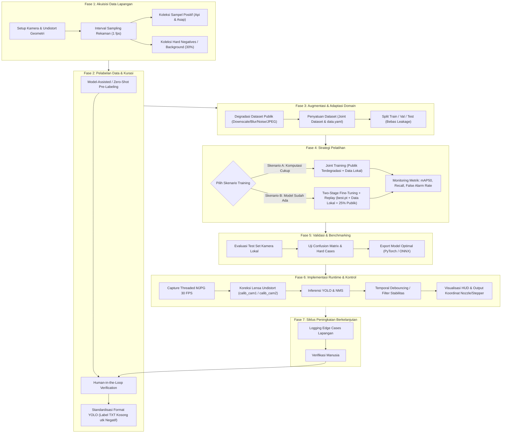

# Pipeline Pengembangan Model Deteksi Api & Asap Berbasis Adaptasi Domain

Dokumen ini merinci *pipeline* menyeluruh (*end-to-end*) mulai dari tahap persiapan dan akuisisi data lapangan hingga implementasi inferensi *real-time* pada kamera berbiaya rendah (*low-cost camera*). Pipeline ini disusun berdasarkan prinsip dan strategi adaptasi domain pada dokumen [`idea.md`](file:///d:/Tugas/Desain%20Proyek/Deezpro/Software/Development/callibration/idea.md) guna mengatasi *domain shift*, *confirmation bias*, dan *catastrophic forgetting*.

---

## Diagram Alur Pipeline Utama



---

## Fase 1: Perencanaan & Pengambilan Data Lapangan (Data Acquisition)

Tujuan fase ini adalah mengumpulkan data visual representatif langsung dari sensor kamera murah yang digunakan pada sistem (Kamera 1 & Kamera 2), mencakup karakteristik sensor nyata seperti noise, saturasi tinggi, dynamic range terbatas, dan aberasi lensa.

### 1.1 Persiapan Perangkat & Lingkungan
1. **Konfigurasi Kamera Statis**:
   - Pasang kamera pada posisi dan ketinggian operasional sebenarnya (*fixed mounting*).
   - Pastikan setelan perangkat keras (*exposure*, *white balance*, *saturation*) diatur secara konsisten (matikan auto-exposure jika menyebabkan fluktuasi pencahayaan ekstrem).
2. **Koreksi Distorsi Lensa Latar Depan**:
   - Simpan citra dalam format mentah atau langsung ter-undistort menggunakan parameter matriks kalibrasi Zhang (`calib_cam1.npz` / `calib_cam2.npz`).
   - Disarankan data latih menggunakan citra yang telah melalui tahap *undistort* agar geometri objek api/asap saat training identik dengan citra saat inferensi *real-time*.

### 1.2 Aturan Sampling Citra Positif (Api & Asap)
1. **Interval Sampling (Anti-Redundansi)**:
   - Hindari mengekstrak frame berurutan dari video (30 fps). Dua frame yang berselisih 33 ms memiliki informasi visual yang hampir identik dan menyebabkan *overfitting*.
   - Ambil sampel dengan interval **1 frame setiap 1 hingga 2 detik**, atau ambil frame hanya ketika lidah api berfluktuasi atau asap telah berganti bentuk dan menyebar.
2. **Variasi Skenario Pembakaran**:
   - Variasi bahan bakar uji coba: kertas, kayu kecil, lilin/paraifin, atau bahan berserat yang menghasilkan asap putih/kelabu/pekat.
   - Variasi skala jarak:
     - Jarak dekat (objek mendominasi $>30\%$ area frame).
     - Jarak menengah ($10\% - 30\%$ area frame).
     - Jarak jauh/titik mula api ($<10\%$ area frame) untuk melatih sensitivitas deteksi dini.
3. **Variasi Kondisi Pencahayaan (Lighting Conditions)**:
   - **Kondisi Terang / Siang Hari**: Mengantisipasi efek *overexposure* di mana api tampak putih pudar tanpa gradasi oranye.
   - **Kondisi Redup / Malam Hari (*Low-Light*)**: Mengambil data dengan sensor grain/noise tebal yang rawan salah dikenali sebagai tekstur asap.
   - **Kondisi Lampu Buatan**: Pencahayaan lampu LED atau neon yang memantul pada lantai atau dinding.

### 1.3 Pengambilan Sampel Negatif / Background (Hard Negatives)
Sampel negatif sangat krusial untuk menekan angka *False Positive Rate* (alarm palsu). Proporsi wajib adalah **30% dari total dataset lokal**.
1. **Objek Pengecoh Lapangan (*Distractors*)**:
   - Lampu sorot, bohlam kuning/oranye, indikator LED terang.
   - Pantulan sinar matahari pada permukaan kaca, logam, atau lantai basah.
   - Uap air mendidih, kabut pendingin ruangan, atau debu beterbangan.
   - Pakaian atau objek berwarna merah/oranye/kuning yang bergerak di area pantauan.
2. **Kondisi Lingkungan Kosong**:
   - Area pantauan dalam berbagai jam (pagi, siang, sore, malam) saat tidak ada api/asap sama sekali.

### 1.4 Target Jumlah Dataset Lokal
- **Target Minimal Operasional (Kamera Statis Sudut Tetap)**: 150 gambar (100 positif api/asap + 50 negatif background).
- **Target Optimal (Variasi Lingkungan Menengah)**: 300 – 500 gambar (350 positif + 150 negatif background).
- **Target Lanjutan (Kamera Bergerak/PTZ & Outdoor Ekstrem)**: 800 – 1.000 gambar.

---

## Fase 2: Anotasi Data & Human-in-the-Loop Verification

Tujuan fase ini adalah menghasilkan anotasi berkualitas tinggi secara cepat tanpa terjebak dalam *confirmation bias* (kesalahan model yang melabeli dirinya sendiri tanpa pengawasan).

### 2.1 Skema Pelabelan Terbantu (Model-Assisted Pre-Labeling)
Gunakan salah satu dari dua pendekatan efisien berikut:
- **Pendekatan A: Zero-Shot Foundation Model**:
  - Gunakan model visi-bahasa seperti **Grounding DINO** atau **Florence-2** dengan *text prompt* spesifik: `"fire, flame, smoke"`.
  - Foundation model memiliki pemahaman semantik yang jauh lebih kuat pada citra berkualitas rendah dibandingkan model detektor kompak.
- **Pendekatan B: Pre-Annotasi Menggunakan Checkpoint YOLO yang Ada**:
  - Gunakan model `best.pt` saat ini dengan ambang keyakinan (*confidence threshold*) tinggi ($\ge 0.85$).
  - Hanya prediksi dengan keyakinan tinggi yang diubah menjadi draf *bounding box*.

### 2.2 Verifikasi Manusia (*Human-in-the-Loop*)
Manusia hanya memverifikasi draf anotasi melalui *tool* pelabelan (seperti Label Studio, CVAT, atau Roboflow):
1. **Koreksi Bounding Box**: Sesuaikan batas kotak yang terlalu longgar atau terlalu sempit.
2. **Penghapusan Deteksi Palsu (*False Positives*)**: Hapus kotak deteksi jika model salah menandai lampu atau pantulan.
3. **Penambahan Deteksi Luput (*False Negatives*)**: Gambar manual kotak untuk api kecil atau asap tipis yang terlewat oleh pre-labeler.

### 2.3 Standarisasi Format YOLO
1. **Pemetaan ID Kelas**:
   - `Class 0`: `smoke` (Asap)
   - `Class 1`: `fire` (Api)
2. **Format Label Koordinat**:
   - Satu baris per objek dalam file `.txt`: `<class_id> <x_center> <y_center> <width> <height>` (ternormalisasi $0.0 - 1.0$).
3. **Format Khusus Sampel Background**:
   - File gambar negatif (`.jpg`) tetap disimpan di folder gambar, tetapi file pasangan `.txt` di folder label dibiarkan **kosong berukuran 0 byte**.
   - Mekanisme ini memberi sinyal eksplisit pada *loss function* YOLO bahwa tidak ada objek bahaya pada pemandangan tersebut.

---

## Fase 3: Kurasi Dataset & Strategi Adaptasi Domain

Tujuan fase ini adalah menyelaraskan karakteristik antara dataset publik beresolusi tinggi dengan dataset kamera murah melalui *data augmentation* dan pengorganisasian data yang tepat.

### 3.1 Degradasi Sintetis Dataset Publik (Domain Adaptation Augmentation)
Dataset publik (misal D-Fire) umumnya memiliki kualitas citra tajam. Agar model tidak kaget menghadapi kamera murah, terapkan filter degradasi pada sebagian data publik:
1. **Resolusi Downscale-Upscale**:
   - Kompresi gambar dari 1080p turun ke 360p atau 480p, lalu naikkan kembali ke 640x640 menggunakan interpolasi linear untuk menciptakan efek buram (*blur* sensor).
2. **Kompresi JPEG Agresif**:
   - Terapkan kompresi kualitas rendah (*Quality Factor* 20–40) untuk memunculkan artefak blok/kompresi khas video streaming CCTV/webcam USB.
3. **Injeksi Noise Sensor**:
   - Tambahkan *Gaussian Noise* atau *Salt-and-Pepper Noise* untuk meniru perilaku sensor CMOS murah pada kondisi minim cahaya.
4. **Distorsi Warna & Kontras (*Color Jitter*)**:
   - Turunkan kontras atau ubah saturasi secara acak untuk meniru *white balance* kamera yang tidak stabil.

### 3.2 Pembagian Dataset (Data Splitting)
Bagi dataset lokal menjadi:
- **Training Set (70% - 80%)**: Digunakan untuk pembaruan bobot model.
- **Validation Set (15% - 20%)**: Digunakan untuk evaluasi berkala selama epoch dan penentuan *early stopping*.
- **Test Set (10% - 15%)**: Disimpan murni untuk pengujian akhir sistem di dunia nyata.
> [!IMPORTANT]
> **Pencegahan Data Leakage**: Frame dari satu sesi pembakaran atau video yang sama harus berada di kelompok yang sama (seluruhnya di train atau seluruhnya di val/test). Jangan memecah frame dari video yang sama ke dalam train dan val.

### 3.3 Penataan Struktur Direktori & Konfigurasi `data.yaml`
Susun struktur data standar Ultralytics YOLO:
```text
dataset_fire_smoke/
├── data.yaml
├── images/
│   ├── train/
│   ├── val/
│   └── test/
└── labels/
    ├── train/
    ├── val/
    └── test/
```
Isi konfigurasi `data.yaml`:
- Jalur path direktori `train`, `val`, dan `test`.
- Jumlah kelas (`nc: 2`).
- Nama kelas: `names: ['smoke', 'fire']`.

---

## Fase 4: Strategi Pelatihan & Fine-Tuning

Tujuan fase ini adalah memperbarui bobot model agar adaptif terhadap kamera murah tanpa melupakan fitur umum api/asap (*catastrophic forgetting*).

### 4.1 Pemilihan Skenario Pelatihan
Pilih salah satu dari dua skenario berikut sesuai kapasitas komputasi:

| Parameter | Skenario A: Joint Training (Direkomendasikan) | Skenario B: Two-Stage Fine-Tuning |
| :--- | :--- | :--- |
| **Kondisi Awal** | Memiliki akses GPU memadai untuk melatih dataset gabungan. | Dataset publik sudah selesai dilatih; komputasi terbatas. |
| **Model Dasar** | Bobot pre-trained COCO resmi (`yolov8n.pt` / `yolo11n.pt`). | Checkpoint model saat ini (`best.pt`). |
| **Komposisi Data** | 100% Dataset Publik Terdegradasi + 100% Dataset Kamera Lokal. | 100% Data Kamera Lokal + 20%–30% Replay Sampel Publik. |
| **Learning Rate** | Standar (`lr0 = 0.01`). | Diturunkan drastis (`lr0 = 0.001` s.d. `0.0005`). |
| **Jumlah Epoch** | 50 – 100 epoch. | 20 – 40 epoch. |
| **Pembekuan Layer** | Semua layer dapat dilatih (*full training*). | *Opsional*: Freeze layer backbone (layer 0–9), hanya latih head deteksi. |
| **Hasil Teknis** | Representasi fitur paling seimbang antara resolusi tinggi & rendah. | Cepat, menjaga representasi lama melalui *experience replay*. |

### 4.2 Parameter Augmentasi Saat Latih
- Ukuran input: `imgsz = 640`.
- Optimasi ukuran batch: Disesuaikan kapasitas VRAM GPU (misal: 16 atau 32).
- Aktifkan augmentasi geometri YOLO: *horizontal flip*, *scale*, *translation*, serta *mosaic* (matikan mosaic pada 10 epoch terakhir untuk stabilitas konvergensi).

### 4.3 Metrik Monitoring & Evaluasi Training
Pantau kurva metrik berikut pada validation set:
1. **mAP@50 (Mean Average Precision pada IoU 0.50)**: Indikator utama akurasi lokalisasi dan klasifikasi.
2. **Recall Per Kelas**:
   - Khusus bahaya kebakaran, nilai *Recall* harus diprioritaskan tinggi agar tidak ada api/asap yang terlewat.
3. **Loss Validasi (Box Loss, Cls Loss, DFL Loss)**:
   - Pastikan tidak terjadi divergensi antara loss latih dan loss validasi (tanda *overfitting*).

---

## Fase 5: Validasi, Benchmark & Optimasi Model

Tujuan fase ini adalah menguji keandalan model pada kondisi nyata sebelum dipasang pada sistem utama.

### 5.1 Pengujian Lapangan pada Test Set Kamera Lokal
1. **Uji Confusion Matrix**:
   - Periksa apakah ada salah klasifikasi antara kelas `smoke` dan `fire`.
   - Periksa persentase latar belakang (*background*) yang keliru diprediksi sebagai api (*false positive*).
2. **Pengujian Ambang Batas (*Confidence Threshold Sweep*)**:
   - Tentukan nilai *threshold* optimal (misal $0.35 - 0.50$) yang menghasilkan *trade-off* terbaik antara *Recall* dan *Precision*.

### 5.2 Optimasi Format Model untuk Inferensi Cepat
- Verifikasi model PyTorch final (`best.pt`).
- Jika inferensi dijalankan pada mini PC/SBC (misal Raspberry Pi, Jetson, atau CPU Intel/AMD tanpa GPU diskrit), ekspor model ke format teroptimasi:
  - **ONNX Runtime** untuk portabilitas.
  - **OpenVINO** untuk akselerasi CPU Intel.
  - **TensorRT** untuk akselerasi GPU NVIDIA.

---

## Fase 6: Integrasi Sistem Runtime & Kontrol

Tujuan fase ini adalah mengintegrasikan model yang telah dilatih ke dalam program deteksi kamera real-time yang sudah ada (`detect_cam1.py`, `detect_cam2.py`, atau `detect_dual_cam.py`).

### 6.1 Alur Pemrosesan Frame Real-Time
1. **Multi-Threaded Video Capture**:
   - Membaca kamera menggunakan backend DirectShow dengan format kompresi hardware **MJPG** pada resolusi 1080p @ 30 FPS untuk menghindari *bottleneck* 5 FPS USB.
2. **Koreksi Distorsi Geometri Lensa (*Undistortion*)**:
   - Menggunakan peta koordinat `cv2.remap()` dari matriks kalibrasi Zhang (`calib_cam1.npz` / `calib_cam2.npz`) sebelum frame diserahkan ke model.
3. **Inferensi YOLO**:
   - Memasukkan frame hasil *undistort* ke model dengan `conf` dan `imgsz` yang telah ditentukan.
   - Ekstraksi informasi: Bounding box $(x_1, y_1, x_2, y_2)$, ID kelas (0: smoke, 1: fire), confidence score, dan titik tengah *centroid* $(c_x, c_y)$.

### 6.2 Filter Stabilitas Deteksi (*Temporal Debouncing*)
Untuk mencegah alarm berkedip (*flickering*) akibat noise sesaat:
- Terapkan mekanisme *sliding window* atau *consecutive frame counter*: Bahaya hanya dinyatakan aktif jika api/asap terdeteksi minimal $K$ frame berturut-turut (misal $K = 5$ frame pada 30 FPS $\approx 0.16$ detik).

### 6.3 Visualisasi HUD & Pengiriman Sinyal Kontrol
1. **Status Banner HUD**:
   - `[OK] MONITORING AMAN` (Hijau) saat tidak ada bahaya.
   - `[!] ASAP TERDETEKSI (jumlah)` (Oranye / Amber) saat hanya asap terdeteksi.
   - `[!] API TERDETEKSI (jumlah)` (Merah terang) saat api terdeteksi.
   - `[!] API & ASAP TERDETEKSI` (Merah peringatan ganda) saat keduanya terdeteksi.
2. **Targeting Nozzle Pemadam**:
   - Hitung offset deviasi koordinat centroid $(c_x, c_y)$ terhadap titik pusat optik frame kamera $(c_{x0}, c_{y0})$.
   - Teruskan koordinat target ke modul kontrol aktuator (motor stepper pan-tilt / nozzle penyemprot air).

---

## Fase 7: Pemeliharaan & Siklus Peningkatan Berkelanjutan (Active Learning Loop)

Tujuan fase ini adalah memastikan model semakin pintar seiring berjalannya waktu operasional tanpa menimbulkan *confirmation bias*.

1. **Perekaman Kasus Sulit (*Hard Negative Logging*)**:
   - Sediakan tombol pintas (misal tombol `'s'`) atau mekanisme otomatis yang menyimpan frame ketika terjadi kesalahan deteksi (misal ada pantulan lampu yang memicu deteksi palsu).
2. **Koleksi & Verifikasi Berkala**:
   - Setiap terkumpul sejumlah frame baru (misal 50–100 gambar kasus sulit), lakukan anotasi ulang dengan verifikasi manusia (*Human-in-the-Loop*).
3. **Retraining Terjadwal (Continuous Fine-Tuning)**:
   - Masukkan sampel sulit tersebut ke dalam dataset latih utama dan jalankan *fine-tuning* periodik dengan learning rate rendah untuk memperbarui bobot model.

---

## Ringkasan Checklist Eksekusi Bertahap

- [ ] **Langkah 1**: Terapkan degradasi sintetis pada dataset publik yang ada (blur, noise, kompresi JPEG) dan uji evaluasinya.
- [ ] **Langkah 2**: Rekam 150–300 frame dari Kamera 1 & Kamera 2 dengan interval sampling 1-2 detik (70% api/asap, 30% background/lampu).
- [ ] **Langkah 3**: Lakukan pre-labeling dengan Foundation Model / model YOLO yang ada, lalu verifikasi manual anotasi tersebut.
- [ ] **Langkah 4**: Gabungkan data lokal dengan dataset publik (metode *Joint Training* atau *Fine-Tuning + Replay*).
- [ ] **Langkah 5**: Latih model, evaluasi metrik mAP50 dan confusion matrix, lalu simpan bobot terbaik (`best.pt`).
- [ ] **Langkah 6**: Integrasikan bobot baru ke dalam `detect_cam1.py` / `detect_cam2.py` dan uji keandalan deteksi serta kestabilan alarm di layar OpenCV.

