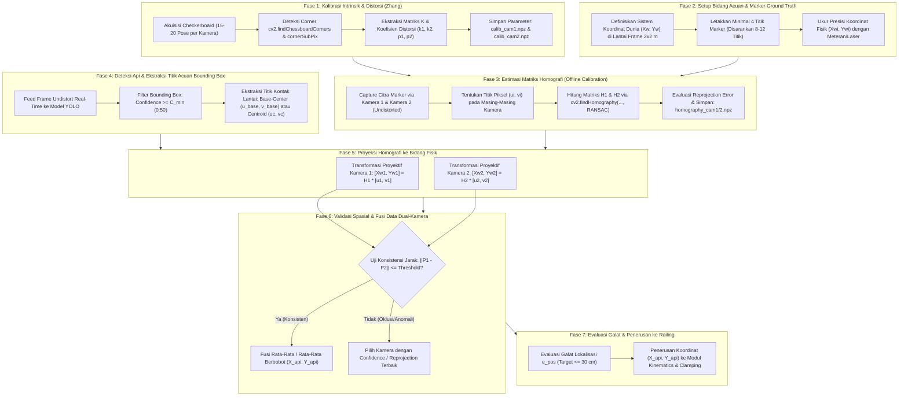

# Pipeline Lokalisasi Api Berbasis Transformasi Homografi Dual-Kamera

Dokumen ini merinci panduan langkah demi langkah (*step-by-step pipeline*) pelaksanaan pemetaan koordinat spasial api dari sistem penglihatan dua kamera (*dual-camera vision*) ke koordinat fisik bidang lantai/bidang kerja ($2 \times 2$ meter). Panduan ini disusun mengacu pada teori dan perumusan matematis pada dokumen **Proposal Desain Proyek 1 (Bab 2 & Bab 4)**, mulai dari kalibrasi distorsi lensa hingga fusi koordinat akhir untuk penggerak railing APAR.

---

## Diagram Alur Pipeline Homografi



---

## Fase 1: Kalibrasi Intrinsik Kamera & Koreksi Distorsi (Metode Zhang)

Sebelum pemetaan homografi planar dapat dilakukan, distorsi optik lensa pada masing-masing kamera murah (terutama distorsi *fisheye*/*wide-angle*) wajib dieliminasi. Transformasi homografi mengasumsikan garis lurus di dunia nyata terproyeksi sebagai garis lurus di citra (*collinearity*), yang hanya berlaku pada citra bebas distorsi.

### 1.1 Persiapan Pola Kalibrasi Papan Catur (*Checkerboard*)
1. Gunakan papan catur standar (misal grid $9 \times 6$ atau $8 \times 6$ titik sudut dalam/*inner corners*) yang dicetak presisi pada bidang datar kaku (akrilik atau papan kayu).
2. Ukur panjang sisi kotak papan catur dalam satuan fisik secara akurat (misal $L_{\text{square}} = 25.0$ mm).
3. Bangun koordinat 3D objek ideal $(X_o, Y_o, 0)$ dengan $Z_o = 0$.

### 1.2 Perekaman Dataset Kalibrasi
1. Posisikan Kamera 1 dan Kamera 2 pada dudukannya yang kokoh.
2. Rekam 15 hingga 25 pasangan citra papan catur dari berbagai sudut kemiringan (*pitch, roll, yaw*), jarak (dekat, sedang, jauh), dan sebaran posisi frame (tengah, tepi, sudut lensa).
3. Pastikan pencahayaan merata dan citra tidak mengalami *motion blur*.

### 1.3 Ekstraksi Parameter Intrinsik & Koefisien Distorsi
1. **Deteksi Titik Sudut**:
   - Cari koordinat kasar titik sudut menggunakan `cv2.findChessboardCorners()`.
   - Lakukan penyempurnaan sub-piksel menggunakan `cv2.cornerSubPix()` dengan kriteria terminasi iterasi ($30$ iterasi atau $\epsilon = 0.001$).
2. **Kalkulasi Parameter Kamera**:
   - Hitung matriks intrinsik $K$ dan koefisien distorsi $D$ menggunakan `cv2.calibrateCamera()`:
     $$K = \begin{bmatrix} f_x & 0 & c_x \\ 0 & f_y & c_y \\ 0 & 0 & 1 \end{bmatrix}, \quad D = \begin{bmatrix} k_1 & k_2 & p_1 & p_2 & k_3 \end{bmatrix}$$
     * $f_x, f_y$: Panjang fokus dalam satuan piksel.
     * $c_x, c_y$: Titik pusat optik (*principal point*).
     * $k_1, k_2, k_3$: Koefisien distorsi radial.
     * $p_1, p_2$: Koefisien distorsi tangensial.
3. **Penyimpanan Matriks Kalibrasi**:
   - Simpan parameter ke file biner: [`calib_cam1.npz`](file:///d:/Tugas/Desain%20Proyek/Deezpro/Software/Development/callibration/calib_cam1.npz) dan [`calib_cam2.npz`](file:///d:/Tugas/Desain%20Proyek/Deezpro/Software/Development/callibration/calib_cam2.npz).
4. **Implementasi Undistort Real-Time**:
   - Gunakan `cv2.initUndistortRectifyMap()` untuk menggenerasi peta piksel $Map_1$ dan $Map_2$ berformat `cv2.CV_16SC2`.
   - Terapkan `cv2.remap()` pada setiap frame video yang ditangkap agar waktu komputasi saat runtime tetap di bawah $5$ ms per frame.

---

## Fase 2: Setup Bidang Acuan & Penentuan Titik Referensi Ground Truth

Fase ini bertujuan mendefinisikan sistem koordinat kartesian global dunia nyata pada bidang lantai di bawah sistem railing $2 \times 2$ meter.

### 2.1 Definisi Sistem Koordinat Dunia ($X_w, Y_w$)
1. Tentukan titik **Origin $(0, 0)$** pada salah satu sudut batas fisik railing (misalnya sudut kiri bawah frame).
2. Tentukan orientasi sumbu:
   - **Sumbu $X_w$**: Bergerak horizontal dari $0$ hingga $M$ ($M = 200$ cm).
   - **Sumbu $Y_w$**: Bergerak vertikal dari $0$ hingga $N$ ($N = 200$ cm).
   - **Sumbu $Z_w = 0$**: Permukaan bidang lantai (karena sistem homografi memetakan ke bidang 2D).

### 2.2 Pemasangan Titik Marker Kalibrasi Homografi
Transformasi homografi memiliki 8 derajat kebebasan (*degrees of freedom*), sehingga secara teoritis membutuhkan **minimal 4 titik korespondensi**. Namun, untuk meminimalkan galat pengukuran dan distorsi perspektif di area tepi, disarankan menggunakan **8 hingga 12 titik marker** yang tersebar merata di seluruh bidang lantai $2 \times 2$ meter.

1. **Tata Letak Marker**:
   - 4 titik di sudut area kerja (misal: $(10, 10)$, $(190, 10)$, $(190, 190)$, $(10, 190)$ dalam cm).
   - 4 titik di tepi tengah (misal: $(100, 10)$, $(190, 100)$, $(100, 190)$, $(10, 100)$ dalam cm).
   - 1 hingga 4 titik di area tengah bidang (misal: $(100, 100)$).
2. **Karakteristik Fisik Marker**:
   - Gunakan penanda berpresisi tinggi dengan titik pusat yang jelas, misalnya pola ArUco Marker, *bullseye target*, atau persilangan garis kontras tinggi.
3. **Pencatatan Koordinat Fisik**:
   - Ukur jarak masing-masing marker ke origin $(0,0)$ menggunakan meteran laser / penggaris baja presisi, lalu catat tabel pasangan data ground truth $P_w = \{(X_{w1}, Y_{w1}), (X_{w2}, Y_{w2}), \dots, (X_{wn}, Y_{wn})\}$.

---

## Fase 3: Estimasi Matriks Homografi ($H_1$ dan $H_2$)

Estimasi matriks homografi dilakukan secara *offline* satu kali untuk masing-masing kamera stasioner.

### 3.1 Akuisisi Titik Citra pada Citra Ter-Undistort
1. Tangkap satu frame beresolusi tinggi dari Kamera 1 dan Kamera 2 dalam keadaan **sudah melalui koreksi undistort** (`cv2.remap`).
2. Identifikasi koordinat piksel $(u_i, v_i)$ dari titik pusat setiap marker pada citra:
   - Dapat dilakukan secara interaktif menggunakan GUI pemilihan titik OpenCV (`cv2.setMouseCallback`) atau deteksi otomatis (ArUco detector).
   - Hasilkan pasangan titik korespondensi untuk masing-masing kamera:
     * Kamera 1: $\{ (u_{1,i}, v_{1,i}) \leftrightarrow (X_{w,i}, Y_{w,i}) \}$
     * Kamera 2: $\{ (u_{2,i}, v_{2,i}) \leftrightarrow (X_{w,i}, Y_{w,i}) \}$

### 3.2 Perhitungan Matriks Homografi via RANSAC
Matriks homografi menghubungkan titik koordinat citra homogen $[u, v, 1]^T$ dengan titik koordinat bidang lantai $[X_w, Y_w, 1]^T$:

$$\begin{bmatrix} s X_w \\ s Y_w \\ s \end{bmatrix} = H \begin{bmatrix} u \\ v \\ 1 \end{bmatrix} = \begin{bmatrix} h_{11} & h_{12} & h_{13} \\ h_{21} & h_{22} & h_{23} \\ h_{31} & h_{32} & h_{33} \end{bmatrix} \begin{bmatrix} u \\ v \\ 1 \end{bmatrix}$$

1. Hitung matriks $H_1$ dan $H_2$ menggunakan fungsi OpenCV:
   ```python
   # H1 untuk Kamera 1, H2 untuk Kamera 2
   H1, mask1 = cv2.findHomography(pts_img1, pts_world, cv2.RANSAC, ransacReprojThreshold=3.0)
   H2, mask2 = cv2.findHomography(pts_img2, pts_world, cv2.RANSAC, ransacReprojThreshold=3.0)
   ```
2. Penggunaan algoritma **RANSAC** (*Random Sample Consensus*) penting untuk mengabaikan titik koordinat piksel yang meleset (*outlier*).

### 3.3 Evaluasi Reprojection Error & Penyimpanan
1. Hitung galat proyeksi ulang (*mean reprojection error*) untuk setiap marker:
   $$\text{Error} = \frac{1}{N} \sum_{i=1}^{N} \sqrt{ (X_{w,i} - \hat{X}_{w,i})^2 + (Y_{w,i} - \hat{Y}_{w,i})^2 }$$
   di mana $(\hat{X}_{w,i}, \hat{Y}_{w,i})$ adalah hasil proyeksi balik koordinat piksel marker ke dunia nyata via matriks $H$.
2. Pastikan rata-rata galat reprojeksi berada **di bawah 2.0 cm** pada bidang lantai.
3. Simpan matriks homografi final ke dalam file konfigurasi: `homography_cam1.npz` dan `homography_cam2.npz`.

---

## Fase 4: Deteksi Api & Ekstraksi Titik Acuan Bounding Box

Saat sistem beroperasi secara *real-time*, citra dari kedua kamera diumpankan ke model YOLO untuk mendeteksi keberadaan objek api dan menentukan titik acuan yang tepat pada bounding box.

### 4.1 Inferensi Real-Time Model YOLO
1. Jalankan inferensi pada frame kamera yang telah di-*undistort* dengan parameter:
   - Model bobot: `best.pt`.
   - Ambang batas keyakinan (*confidence threshold*): $C_{\text{fire}} \ge 0.50$.
   - Non-Maximum Suppression (IoU threshold): $0.45$.
2. Ekstraksi koordinat bounding box piksel: $[x_1, y_1, x_2, y_2]$ (kiri-atas dan kanan-bawah).

### 4.2 Penentuan Titik Representasi Api pada Bidang Citra
Dalam pemetaan homografi ke bidang lantai, pemilihan titik pada bounding box memegang peranan krusial:

> [!IMPORTANT]
> **Pertimbangan Titik Kontak Lantai (*Ground Contact Point*)**:
> Transformasi homografi mengasumsikan titik yang diproyeksikan berada tepat pada bidang referensi $Z_w = 0$ (lantai).
> - **Centroid Geometris** $(u_c, v_c) = \left(\frac{x_1 + x_2}{2}, \frac{y_1 + y_2}{2}\right)$: Merepresentasikan pusat kobaran api. Namun, karena lidah api menjulang ke atas secara vertikal dari lantai, centroid berada pada ketinggian $Z > 0$, yang dapat menimbulkan pergeseran paralaks perspektif jika kamera memandang dengan sudut miring.
> - **Titik Dasar Api (*Base-Center*)** $(u_b, v_b) = \left(\frac{x_1 + x_2}{2}, y_2\right)$: Merepresentasikan titik di mana dasar api menyentuh lantai ($Z_w \approx 0$).
> 
> **Rekomendasi Operasional**:
> - Gunakan titik **Base-Center $(u_b, v_b)$** jika api berupa sumber pembakaran di lantai (kertas, tempat sampah, tumpahan bahan bakar).
> - Gunakan titik **Centroid $(u_c, v_c)$** sesuai rumusan standar Proposal (Bagian 4.2.1), dengan kompensasi fusi dua sudut kamera yang berlawanan untuk membatalkan efek paralaks.

---

## Fase 5: Proyeksi Homografi ke Bidang Fisik Dunia

Setelah titik acuan citra $(u, v)$ diperoleh dari bounding box pada masing-masing kamera, lakukan transformasi proyektif ke sistem koordinat lantai.

### 5.1 Perhitungan Matematis Transformasi
Berdasarkan perumusan matematis pada Proposal Bagian 2.2.4 dan 4.2.2:

$$X_w = \frac{h_{11}u + h_{12}v + h_{13}}{h_{31}u + h_{32}v + h_{33}}$$

$$Y_w = \frac{h_{21}u + h_{22}v + h_{23}}{h_{31}u + h_{32}v + h_{33}}$$

### 5.2 Eksekusi Proyeksi Terpisah Dual-Kamera
1. **Dari Kamera 1 (menggunakan matriks $H_1$)**:
   - Masukkan titik $(u_1, v_1)$ ke formula transformasi di atas.
   - Hasilkan estimasi koordinat spasial: $(X_{w1}, Y_{w1})$.
2. **Dari Kamera 2 (menggunakan matriks $H_2$)**:
   - Masukkan titik $(u_2, v_2)$ ke formula transformasi di atas.
   - Hasilkan estimasi koordinat spasial: $(X_{w2}, Y_{w2})$.

---

## Fase 6: Validasi Spasial & Fusi Data Dual-Kamera

Karena sistem menggunakan dua kamera yang mengamati area kerja dari sudut berbeda, data dari kedua kamera harus difusi secara cerdas untuk menghasilkan estimasi posisi tunggal yang tangguh terhadap oklusi.

### 6.1 Uji Konsistensi Spasial (Distance Validation Check)
Hitung jarak Euclidean antara estimasi Kamera 1 dan Kamera 2:

$$d_{12} = \sqrt{(X_{w1} - X_{w2})^2 + (Y_{w1} - Y_{w2})^2}$$

* **Kondisi Normal ($d_{12} \le \text{Threshold}$, misal $\le 40$ cm)**:
  Kedua kamera sepakat terhadap lokasi api. Lanjutkan ke tahap fusi rata-rata.
* **Kondisi Anomali ($d_{12} > \text{Threshold}$)**:
  Terjadi perbedaan signifikan (misal salah satu kamera terhalang asap tebal, bayangan, atau mengalami deteksi palsu).
  - Terapkan mekanisme *fallback*: Pilih kamera yang memiliki *confidence score* YOLO lebih tinggi atau yang reprojection error kalibrasinya lebih rendah.

### 6.2 Fusi Koordinat Akhir
Jika kedua estimasi konsisten, hitung koordinat api akhir $(X_{\text{api}}, Y_{\text{api}})$:

1. **Metode Rata-Rata Standar (Simple Average)**:
   $$X_{\text{api}} = \frac{X_{w1} + X_{w2}}{2}, \quad Y_{\text{api}} = \frac{Y_{w1} + Y_{w2}}{2}$$

2. **Metode Rata-Rata Berbobot (Weighted Average Berdasarkan Confidence)**:
   Sesuai Proposal Bagian 4.2.2, jika salah satu kamera memiliki tingkat keyakinan deteksi lebih tinggi:
   $$X_{\text{api}} = \frac{w_1 X_{w1} + w_2 X_{w2}}{w_1 + w_2}, \quad Y_{\text{api}} = \frac{w_1 Y_{w1} + w_2 Y_{w2}}{w_1 + w_2}$$
   di mana $w_1 = C_{\text{fire1}}$ dan $w_2 = C_{\text{fire2}}$.

### 6.3 Filter Temporal (Anti-Flickering / Smoothing)
Untuk menghindari jitter akibat fluktuasi bentuk lidah api antar-frame:
- Terapkan filter rata-rata bergerak (*Moving Average Filter*) atau *Exponential Moving Average (EMA)* pada 5 frame berturut-turut:
  $$P_{\text{smooth}}^{(t)} = \alpha P_{\text{api}}^{(t)} + (1 - \alpha) P_{\text{smooth}}^{(t-1)}, \quad \text{dengan } \alpha = 0.6$$

---

## Fase 7: Evaluasi Galat Lokalisasi & Integrasi ke Sistem Railing

Fase terakhir adalah memvalidasi tingkat akurasi lokalisasi dan menyerahkan koordinat hasil fusi ke modul aktuator APAR.

### 7.1 Perhitungan Galat Lokalisasi Terhadap Ground Truth
Sesuai Proposal Bagian 4.2.3, evaluasi sistem dilakukan dengan meletakkan sumber api uji pada titik referensi yang diketahui $(X_r, Y_r)$:

1. **Galat Posisi Euclidean ($e_{\text{pos}}$)**:
   $$e_{\text{pos}} = \sqrt{(X_{\text{api}} - X_r)^2 + (Y_{\text{api}} - Y_r)^2}$$
2. **Kriteria Keberhasilan Desain**:
   Sesuai target spesifikasi rancangan proposal (Bagian 4.2.3 dan 5.2.1), galat lokalisasi maksimum sistem adalah:
   $$e_{\text{pos}} \le 30 \text{ cm pada area kerja } 2 \times 2 \text{ meter}$$
3. **Rata-Rata Galat Keseluruhan ($\bar{e}$)**:
   $$\bar{e} = \frac{1}{n} \sum_{i=1}^{n} e_i$$
   Pengujian diulang pada minimal 10–15 titik uji acak di seluruh kuadran bidang kerja.

### 7.2 Penerusan Data ke Modul Kinematics & Kontrol Motor Stepper
Koordinat hasil lokalisasi $(X_{\text{api}}, Y_{\text{api}})$ langsung diserahkan ke pipeline kendali gerak (sebagaimana didefinisikan pada [`ACTION_PLAN_CONTROL.md`](file:///d:/Tugas/Desain%20Proyek/Deezpro/Software/Development/esp32-src/ACTION_PLAN_CONTROL.md)):
1. **Clamping Batas Clearance Railing**:
   $$X_{\text{target}} = \max\left(m, \min\left(X_{\text{api}}, M - m\right)\right)$$
   $$Y_{\text{target}} = \max\left(n, \min\left(Y_{\text{api}}, N - n\right)\right)$$
2. **Konversi ke Perintah Step Motor**:
   $$\text{Target\_Step}_X = \text{round}\left( \frac{X_{\text{target}} - m}{M - 2m} \times P \right)$$
   $$\text{Target\_Step}_Y = \text{round}\left( \frac{Y_{\text{target}} - n}{N - 2n} \times Q \right)$$
3. **Transmisi MQTT**:
   - Kirim `{"cmd": "GOTO", "target": Target_Step_X}` ke ESP 1 via topik `deezpro/rail/x/cmd`.
   - Kirim `{"cmd": "GOTO", "target": Target_Step_Y}` ke ESP 2 via topik `deezpro/rail/y/cmd`.

---

## Ringkasan Checklist Eksekusi Bertahap

- [ ] **Langkah 1**: Ambil 20 citra papan catur dari Kamera 1 & Kamera 2, lalu proses kalibrasi Zhang hingga menghasilkan `calib_cam1.npz` dan `calib_cam2.npz` (reprojection error $< 0.5$ px).
- [ ] **Langkah 2**: Pasang 8–12 marker acuan pada lantai bidang kerja $2 \times 2$ m dan ukur koordinat fisik $(X_w, Y_w)$ dengan presisi tinggi.
- [ ] **Langkah 3**: Ekstrak koordinat piksel marker dari frame ter-undistort kedua kamera, lalu hitung matriks homografi $H_1$ dan $H_2$ menggunakan `cv2.findHomography(..., cv2.RANSAC)`.
- [ ] **Langkah 4**: Simpan matriks ke `homography_cam1.npz` dan `homography_cam2.npz`, lalu pastikan galat reprojeksi marker $< 2$ cm.
- [ ] **Langkah 5**: Integrasikan modul homografi ke dalam skrip deteksi real-time dual-kamera: ekstraksi bounding box $\to$ tentukan titik kontak dasar api $(u, v) \to$ proyeksikan via $H_1$ dan $H_2$.
- [ ] **Langkah 6**: Terapkan fusi koordinat rata-rata / rata-rata berbobot beserta filter konsistensi jarak antar-kamera.
- [ ] **Langkah 7**: Lakukan uji validasi menggunakan sumber api nyata/tiruan pada 10 titik acuan berbeda untuk memastikan galat lokalisasi $e_{\text{pos}} \le 30$ cm sebelum dihubungkan ke penggerak motor railing.

