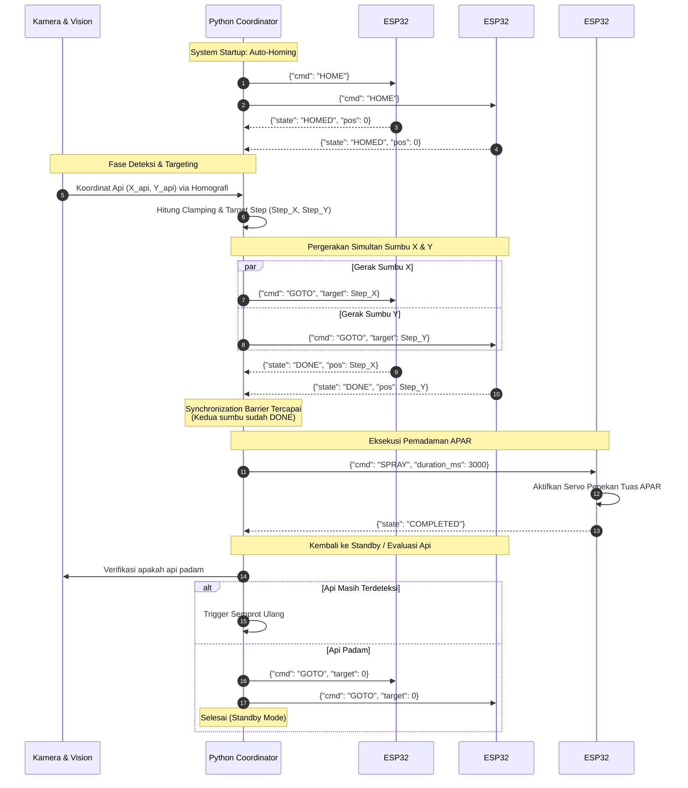

# Action Plan: Sistem Kontrol Otomatis APAR Berbasis Koordinat & MQTT (3x ESP32)

Dokumen ini merupakan tindak lanjut (*action plan*) teknis yang disusun berdasarkan rancangan kebutuhan pada [`control_plan.md`](file:///d:/Tugas/Desain%20Proyek/Deezpro/Software/Development/esp32-src/control_plan.md). Rencana ini memetakan arsitektur sistem, standardisasi protokol komunikasi MQTT, formulasi matematis translasi koordinat ke step, serta tahapan implementasi bertahap dari level firmware hingga integrasi *end-to-end*.

---

## 1. Analisis & Rekomendasi Terhadap Poin Pertimbangan

Berikut adalah analisis dan keputusan teknis atas pertimbangan yang dicantumkan pada `control_plan.md`:

### 1.1 Lokasi Perhitungan Step: Python Coordinator (Host) vs ESP32 (Edge)
* **Keputusan**: **Perhitungan step dilakukan di Python Coordinator (Host/PC)**, bukan di ESP32.
* **Alasan Teknis**:
  1. **Separation of Concerns (Pemisahan Tanggung Jawab)**: ESP32 difokuskan sebagai *hardware controller* deterministik real-time yang mengeksekusi profil akselerasi stepper (*AccelStepper*) dan membaca *limit switch*. ESP32 tidak perlu terbebani logika floating-point frame, transformasi matriks, maupun batas geometri.
  2. **Fleksibilitas Konfigurasi**: Parameter mekanis seperti panjang frame ($M, N$), *clearance* ($m, n$), dan total step ($P, Q$) dapat diubah atau dikalibrasi ulang hanya melalui satu file konfigurasi di PC tanpa perlu melakukan flashing ulang firmware pada ketiga ESP32.
  3. **Logika Clamping & Safety Check**: Logika pencarian titik terdekat (*nearest reachable point*) dan validasi boundary jangkauan fisik paling aman dievaluasi di layer koordinasi sebelum perintah dikirim ke jaringan MQTT.

---

### 1.2 Manajemen State Global (Koordinat & Step Terakhir)
* **Keputusan**: **In-Memory State Coordinator (Python) dengan Pencatatan Persisten ke SQLite & JSON Config**.
* **Alasan Teknis**:
  1. **Akses Berkecepatan Tinggi**: State dinamis (apakah motor X sedang bergerak, posisi step saat ini, status servo) berubah dalam hitungan milidetik. State ini dikelola langsung di memori oleh Python Coordinator (*singleton state machine*).
  2. **Penyimpanan Konfigurasi (`config.json`)**: Menyimpan dimensi fisik ($M, N, m, n$), resolusi ($P, Q$), koefisien kecepatan/akselerasi, dan parameter MQTT broker.
  3. **Penyimpanan Riwayat Insiden (SQLite Database)**: Mencatat setiap insiden kebakaran: timestamp deteksi, koordinat api $(X_f, Y_f)$, koordinat target $(X_t, Y_t)$, total step X & Y, durasi pergerakan, status pemadaman, dan jalur file foto snapshot sebelum/sesudah pemadaman.
  4. **Prosedur Homing (Wajib)**: Motor stepper bersifat *open-loop*. Jika sistem dimatikan atau listrik terputus, posisi di memori bisa kehilangan sinkronisasi dengan posisi fisik (*lost steps*). Sistem **wajib** memiliki limit switch di titik $(0,0)$ dan menjalankan prosedur *Auto-Homing* setiap kali sistem di-boot ulang.

---

### 1.3 Arsitektur Sistem Umum (Frontend, Backend, View Kamera, & Logging)
* **Arsitektur Tiga Layer**:
  1. **Layer Vision (Input)**: Menjalankan deteksi api/asap YOLO, men-transformasikan bounding box piksel ke koordinat dunia nyata $(X, Y)$ via matriks homografi, lalu mengirimkan data target ke Backend.
  2. **Layer Backend (Coordinator Engine)**:
     - Menerima koordinat api dari Vision.
     - Melakukan *clamping* boundary terhadap *clearance* rail.
     - Menghitung target step untuk Sumbu X dan Sumbu Y.
     - Mengirim perintah secara simultan ke ESP 1 & ESP 2 melalui MQTT.
     - Mengimplementasikan **Synchronization Barrier**: Menunggu kedua ESP mengirimkan status `DONE` sebelum memicu ESP 3 (Servo APAR).
     - Memicu ESP 3 untuk menyemprotkan APAR selama durasi tertentu.
     - Mengembalikan nozzle ke posisi *standby/home* setelah selesai.
  3. **Layer Frontend (Operator Dashboard - Web GUI)**:
     - **Live View Kamera**: Menampilkan streaming video kamera dengan visualisasi bounding box api, titik tengah target (*crosshair*), dan proyeksi grid area.
     - **Digital Twin 2D Railing Canvas**: Menampilkan representasi visual 2D bidang $M \times N$, area clearance (merah/arsir), posisi nozzle saat ini, serta titik api terdeteksi secara real-time.
     - **Status & Telemetri**: Status koneksi 3x ESP32 (Online/Offline, WiFi RSSI), posisi step X & Y, dan status aktuator APAR (Idle/Moving/Spraying).
     - **Manual Override Controls**: Tombol *Emergency Stop (E-STOP)*, tombol *Homing*, tombol *Manual Jog* (gerak X/Y manual), dan tombol *Test Spray APAR*.
     - **Event Log**: Tabel riwayat insiden dan pemadaman kebakaran.

---

### 1.4 Standardisasi Format Komunikasi MQTT (Topik & Payload)

Untuk keterbacaan, keandalan, dan kemudahan parsing, format komunikasi MQTT distandarisasi menggunakan **struktur hirarkis topik** dengan **payload JSON terstruktur**.

#### Struktur Topik MQTT:
| Device / Node | Topic Command (Subscribe oleh Node) | Topic Status (Publish oleh Node) |
| :--- | :--- | :--- |
| **ESP 1 (Sumbu X)** | `deezpro/rail/x/cmd` | `deezpro/rail/x/status` |
| **ESP 2 (Sumbu Y)** | `deezpro/rail/y/cmd` | `deezpro/rail/y/status` |
| **ESP 3 (Servo APAR)**| `deezpro/apar/cmd` | `deezpro/apar/status` |
| **Sistem Global** | `deezpro/system/cmd` | `deezpro/system/status` |

#### Spesifikasi Payload Perintah (Command Payload):
1. **Perintah Stepper (ESP 1 & ESP 2)**:
   ```json
   // Gerak ke posisi step absolut (rekomendasi operasi koordinat)
   {"cmd": "GOTO", "target": 1850, "speed": 1000, "accel": 500}

   // Gerak relatif (manual tuning)
   {"cmd": "MOVE", "steps": 200}

   // Auto-Homing ke limit switch
   {"cmd": "HOME"}

   // Hentikan gerakan seketika (Emergency / Halt)
   {"cmd": "STOP"}

   // Reset titik nol manual
   {"cmd": "SET_ZERO"}
   ```

2. **Perintah Servo APAR (ESP 3)**:
   ```json
   // Semprot APAR selama durasi tertentu (milidetik)
   {"cmd": "SPRAY", "duration_ms": 3000}

   // Lepas / tutup tuas APAR seketika
   {"cmd": "RELEASE"}

   // Uji posisi sudut servo
   {"cmd": "SET_ANGLE", "angle": 90}
   ```

3. **Perintah Broadcast Global**:
   ```json
   {"cmd": "EMERGENCY_STOP"}
   {"cmd": "HOME_ALL"}
   ```

#### Spesifikasi Payload Status / Umpan Balik (Status Payload):
1. **Status Stepper (ESP 1 & ESP 2)**:
   ```json
   // Saat motor selesai mencapai target
   {"node": "x", "state": "DONE", "pos": 1850}

   // Laporan periodik saat bergerak
   {"node": "x", "state": "MOVING", "pos": 1200, "target": 1850}

   // Status homing
   {"node": "x", "state": "HOMED", "pos": 0}

   // Status error/limit switch
   {"node": "x", "state": "ERROR", "msg": "Limit switch hit prematurely"}
   ```

2. **Status Servo APAR (ESP 3)**:
   ```json
   // Siap siaga
   {"node": "apar", "state": "READY"}

   // Sedang menyemprot
   {"node": "apar", "state": "SPRAYING", "remaining_ms": 1200}

   // Selesai menyemprot
   {"node": "apar", "state": "COMPLETED"}
   ```

---

## 2. Formulasi Matematis: Translasi Koordinat, Clearance & Clamping

### 2.1 Definisi Variabel
* Panjang total frame fisik: $M$ (Sumbu X) dan $N$ (Sumbu Y) dalam satuan cm atau meter.
* Clearance batas railing: $m$ cm pada kedua sisi sumbu X, $n$ cm pada kedua sisi sumbu Y.
* Jangkauan gerak fisik efektif (*Effective Travel*):
  $$\Delta X_{\text{max}} = M - 2m$$
  $$\Delta Y_{\text{max}} = N - 2n$$
* Resolusi step ujung-ke-ujung (*Total Steps over Effective Travel*):
  * Sumbu X: $P$ step.
  * Sumbu Y: $Q$ step.
* Faktor konversi step per satuan panjang ($k_x, k_y$):
  $$k_x = \frac{P}{\Delta X_{\text{max}}} = \frac{P}{M - 2m}$$
  $$k_y = \frac{Q}{\Delta Y_{\text{max}}} = \frac{Q}{N - 2n}$$

---

### 2.2 Logika Clamping (Mencari Titik Terdekat)
Jika koordinat api $(X_{\text{api}}, Y_{\text{api}})$ terdeteksi di luar jangkauan railing (berada di zona *clearance* $m$ atau $n$), titik target nozzle $(X_{\text{target}}, Y_{\text{target}})$ dihitung dengan fungsi penjepitan (*clamping*):

$$X_{\text{target}} = \max\left(m, \min\left(X_{\text{api}}, M - m\right)\right)$$
$$Y_{\text{target}} = \max\left(n, \min\left(Y_{\text{api}}, N - n\right)\right)$$

Dengan formulasi ini:
- Jika api berada di dalam jangkauan efektif, nozzle akan tepat berada di atas api ($X_{\text{target}} = X_{\text{api}}$).
- Jika api berada di zona sudut atau tepi *clearance*, nozzle akan berhenti pada koordinat railing terdekat yang masih dalam batas aman jangkauan fisik.

---

### 2.3 Konversi Koordinat Target ke Target Step
Dengan menetapkan titik $(X=m, Y=n)$ sebagai posisi awal (Step 0):
$$\text{Target\_Step}_X = \text{round}\left( (X_{\text{target}} - m) \times k_x \right) = \text{round}\left( \frac{X_{\text{target}} - m}{M - 2m} \times P \right)$$
$$\text{Target\_Step}_Y = \text{round}\left( (Y_{\text{target}} - n) \times k_y \right) = \text{round}\left( \frac{Y_{\text{target}} - n}{N - 2n} \times Q \right)$$

Batasan keamanan software (*Software Endstop*):
$$0 \le \text{Target\_Step}_X \le P$$
$$0 \le \text{Target\_Step}_Y \le Q$$

---

## 3. Diagram Alur Kerja Sistem (System Sequence Flow)



---

## 4. Rincian Action Plan Pelaksanaan (5 Tahap Eksekusi)

### Tahap 1: Standardisasi & Pembaruan Firmware ESP32
1. **Sumbu X & Y (`stepper-x.ino`, `stepper-y.ino`)**:
   - Refactor kode `stepper-test.ino` dan `stepper-test-2.ino` agar mendukung parsing format JSON standar.
   - Tambahkan integrasi **Limit Switch** pada pin input (pull-up internal) untuk fungsi `HOME`.
   - Implementasikan *software endstop* agar motor tidak menerima step di luar range $0$ sampai $P$ (atau $Q$).
   - Terbitkan status `DONE` yang konsisten saat `!stepper.isRunning()`.
2. **Servo APAR (`apar-servo.ino`)**:
   - Buat firmware baru untuk ESP 3 menggunakan pustaka `ESP32Servo` dan `PubSubClient`.
   - Kalibrasi sudut servo untuk 2 posisi: `POS_IDLE` (tuas bebas) dan `POS_PRESS` (tuas tertekan penuh).
   - Implementasikan *non-blocking timer* menggunakan `millis()` agar saat durasi `SPRAY` berlangsung, koneksi MQTT tetap terjaga tanpa terblokir oleh `delay()`.

### Tahap 2: Pengembangan Python Coordinator Core & Kinematics Engine
1. **Module Kinematics (`kinematics.py`)**:
   - Fungsi hitung *clamping* boundary terhadap $M, N, m, n$.
   - Fungsi konversi koordinat meter/cm ke nilai *step integer* $P, Q$.
2. **Module MQTT Coordinator (`coordinator.py`)**:
   - Mengelola koneksi MQTT ke broker dengan *auto-reconnect*.
   - Menyediakan antarmuka perintah `goto_coordinate(x, y)`.
   - Mengimplementasikan *Synchronization Barrier* menggunakan threading `Event` atau status tracker untuk memastikan Sumbu X dan Y selesai sebelum memerintahkan semprot.
   - State Machine: `IDLE`, `HOMING`, `MOVING`, `IN_POSITION`, `SPRAYING`, `EMERGENCY_STOP`.
3. **Module Persistence (`state_store.py`)**:
   - Penyimpanan konfigurasi di `config.json`.
   - Pencatatan log insiden ke SQLite (`deezpro_log.db`).

### Tahap 3: Integrasi Pipeline Vision (Kamera -> Homografi -> Coordinator)
1. **Integrasi Matriks Homografi**:
   - Kalibrasi bidang lantai/frame 2x2 meter untuk mendapatkan matriks homografi $H$.
   - Transformasi koordinat piksel centroid api $(u, v)$ dari `detect_cam1.py` / `detect_cam2.py` menjadi koordinat dunia $(X_{\text{api}}, Y_{\text{api}})$.
2. **Filter Stabilitas Target (Debouncing & Temporal Filter)**:
   - Menghindari pergerakan motor akibat deteksi palsu sesaat (*noise*).
   - Pastikan koordinat target stabil dalam radius toleransi tertentu selama minimal $\ge 5$ frame sebelum perintah gerak dikirim ke motor.

### Tahap 4: Pengembangan Operator Dashboard (Frontend UI)
1. **Web / GUI Interface**:
   - Stream video live dari kamera deteksi dengan bounding box dan koordinat api.
   - Kanvas visualisasi 2D: posisi nozzle vs posisi api vs area clearance.
   - Widget status koneksi dan telemetri (ESP1, ESP2, ESP3).
2. **Kontrol Manual & Emergency Override**:
   - Tombol Darurat *E-STOP* berwarna merah mencolok untuk membatalkan seluruh proses seketika.
   - Tombol *Homing* dan slider kecepatan.

### Tahap 5: Pengujian Terintegrasi & Kalibrasi Fisik
1. **Uji Kalibrasi Batas Railing**:
   - Mengukur nilai riil $P$ dan $Q$ di lapangan dengan menggerakkan motor dari ujung limit switch satu ke ujung lainnya.
   - Mengukur clearance riil $m$ dan $n$ pada struktur fisik.
2. **Uji Respons Clamping**:
   - Mensimulasikan titik api di dalam clearance (misal $X = 5$ cm padahal $m = 10$ cm) dan memastikan nozzle berhenti di $X = 10$ cm.
3. **Uji Simultanitas & Synchronization**:
   - Memastikan ESP 1 dan ESP 2 mulai bergerak serentak dan ESP 3 baru menyemprot setelah keduanya benar-benar berhenti.
4. **Uji Pemadaman Riil & Safety Failsafe**:
   - Uji respon ketika koneksi WiFi/MQTT putus saat motor bergerak (*fail-safe stop*).

---

## 5. Ringkasan Checklist Kesiapan Implementasi

- [ ] Konfigurasi pinout Limit Switch X dan Limit Switch Y pada ESP32.
- [ ] Pengukuran fisik definitif nilai $M, N, m, n, P, Q$.
- [ ] Refactor firmware ESP 1 dan ESP 2 ke format MQTT JSON & Homing.
- [ ] Pembuatan firmware ESP 3 (Servo APAR).
- [ ] Penulisan modul `kinematics.py` dan `coordinator.py` di Python.
- [ ] Integrasi output koordinat dari modul deteksi kamera (`detect_cam1.py`).
- [ ] Uji fungsionalitas barrier sinkronisasi (`MOVING` $\to$ `DONE` $\to$ `SPRAY`).

